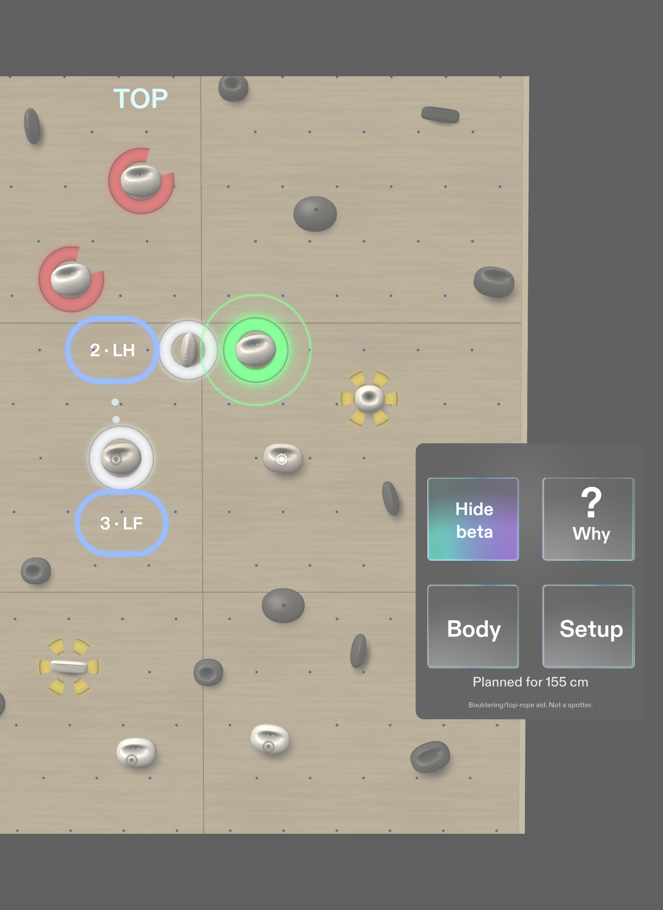
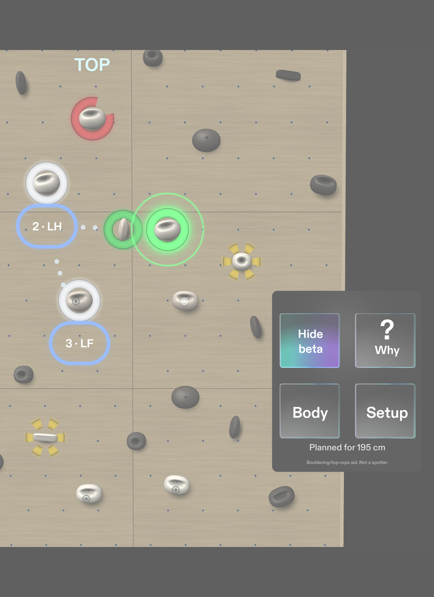

# Next Hold: the Devpost story

This is the text published on https://devpost.com/software/next-hold (8 Nov 2026, after the SPECS live review). Earlier versions are in `archive/`.

## In four lines
- **The problem:** newer boulderers stall halfway up a problem because they can't see their options from where they hang, and a phone means letting go of the wall.
- **Who it's for:** indoor boulderers, especially in their first year, at any height.
- **Why glasses:** the advice sits on the holds themselves, hands stay on the wall, eyes stay up.
- **What's new:** a coach, not an answer key. It plans *your* route for your height and keeps it to itself until you ask. On 300 random problems, a 155 cm and a 195 cm climber get a different 1-2-3 on 93–97% of the problems both can finish (ten random seeds: 92.7–96.7%; `tests/measure_heights.mjs`, the Lens's own route search).

 

## What changed after the SPECS live review
In the live review, a reviewer who boulders asked a fair question: if the glasses show you the route, where's the fun of working it out? So Next Hold now stays quiet until you ask. From the mats you see only the problem's holds, with START and TOP, and your plan appears when you pinch "Show my beta". On the wall, "?" gives as little as you need, one pinch at a time: the holds in reach, then the next move, then why it works. Come off, and it offers a hint for just that move, or Again. A top ends in climbing's own words (ONSIGHT, FLASH or SEND, then REPEAT) with your moves against the shortest route for you and the hints you took, kept on this device. That is the score, and a reason to go again. There's no timer, because rushing on a wall is how people get hurt. You mark the problem's holds yourself, so the Lens never has to read a gym's colours, and every mark stays visible to check. Your height is set once in Setup and kept. The preview has no body to measure; on SPECS the first number could come from your eye height on the mats, and you'd only confirm it. The controls went from ten small buttons to four large ones on the mats, where the panel follows your head, and two on the wall, beside your hands. And because your hands are busy, four short phrases press the same buttons: "next hold", "why", "show my beta" and "again". Speech recognition is available only on Spectacles, and its API reports a NoInternet status without a network; we have tried the phrases only as typed text in the preview, and the preview says so on screen. Each change has a LEAF check like the rest: 37 of 37 in the last full run (`devpost/LEAF_RUN_2026-11-06_s28.txt`).

## What it does
You stand on the mats, about two and a half metres back, and read the problem you've marked, the way climbers do before they start. With your beta hidden, which is how it opens, the problem's holds have a plain outline, with START and TOP; holds that aren't part of it fade back. Pinch "Show my beta" and every free hold gets its ring, and the colour never works alone: a solid green ring is a secure grip, a dashed yellow ring is harder, a red ring with a gap is out of reach or too hard from where you are, for the hand or foot a pinch there would move. The best next move glows with its label, "R hand", and the two moves after it are small blue badges on their own holds, "2 · LH" and "3 · LF". A badge is never green, yellow or red, and the hold under it keeps a plain outline, so a colour on the wall always means a grip.

Then you climb. Up close the glasses see about one hold at a time, so when you come closer than about 80 cm the Lens switches to **On wall** by itself, and there it's quiet: only the markers on the holds you're on. Stuck? "?" gives a hint a step at a time: the holds in reach, then the next move, then why it works (the third pinch puts "jug, sets up LH to the pinch" under "R hand", just above the glowing hold). Step back past about 1.2 m and the whole problem is there again. When the next move is shown and its hold is out of view, an arrow at the edge and a soft chime point you to it.

The colour isn't a guess about the route. It's worked out from where your body is right now:
- **Grip:** a jug is easier to hold than a crimp, a crimp easier than a sloper.
- **Reach:** how far the hold is from the shoulder of the hand, or the hip of the foot, that would move, against your own reach. Past it, the hold is always red. Feet reach from the hip: a rock-over about 40 cm under your hands is green, and a foot well above your hip is a "HIGH STEP" and goes hard.
- **Balance:** a hand move is better with both feet on and the new hold above your centre of mass; crossing your body costs.
- **Upward:** among moves that are about as good, the one that takes you higher and closer to the top hold wins.

The 1-2-3 is a plan, not three greedy guesses. The Lens searches every hand and foot and every hold of the problem for the shortest way to the top in moves you can make (green or yellow), and among those the most secure. The glow is the surest move that stays on a shortest route, so following it takes exactly the shortest route for your height. You set your height in Setup (150 to 200 cm), it's kept for next time, and every reach rescales. From the same start, a 155 cm climber gets "R hand up, then L hand to the pinch, then L foot up"; from about 185 cm the left hand goes straight to the big jug up and left of the pinch instead. The two images at the top show it. To be clear: we set up the demo wall to show this. We moved hold h10 to a big jug up and to the left and added it to the problem, because on the old problem every height got the same three moves. The route search itself is general and doesn't know about h10: the port test checks it against a brute force over every route on the demo problem at 7 heights (150 to 200 cm), starting with each of the 4 limbs, and `tests/measure_heights.mjs` runs it on 300 random problems.

Top out and "TOP" turns into a green "TOPPED", then a card: "SEND · go 2", "4 moves · the shortest for you" and "1 hint · sent! Again without it?" (the demo take's card, checked word for word by LEAF d2; still: `S08_result_card.png`). Come off on the way, and a card says so and offers [Hint · move 3] [Again].

## Who it's for
Indoor boulderers, especially newer ones, who stall halfway up a problem because they can't see their options from where they hang. A phone can't help there: you'd have to let go of the wall to look at it, and a beta video has to be studied before you start, not while you're on the problem.

## How it's different
Gyms already light up holds: LED training boards and projected walls show a set problem to everyone who looks, and logbook apps keep your ticks. Those are the familiar parts. The new part is a plan for your body, on the real holds, on glasses, shown only when you ask. Two people on the same problem see different colours when they ask for their beta, and can get a different 1-2-3. We don't claim "first".

## Why it needs glasses
- **It draws in the world.** The rings sit flat on the holds themselves, at real size, not on a panel.
- **It leaves your body free.** Hands stay on the holds, eyes stay up the wall, and a short phrase can stand in for a pinch.
- **On real SPECS it would share your view,** seeing the holds you're looking at.
Green never means "safe". It means "a secure grip for you, from where you are now". The panel says so in one line: "Bouldering/top-rope aid. Not a spotter."

## What's real and what's stood in
The preview can't recognise a real wall or track a body, so, as the rules suggest, we faked the moment of recognition and built everything after it for real:
- **The wall** is a virtual bouldering wall at real scale, 240 × 300 cm. In the preview you walk back from it to read the problem.
- **Hold recognition** is marking by hand: pinch a hold to add it, set its type, Start and Top, and press Done. A wrong mark can change the plan, not just one ring, so every mark stays visible to check.
- **Body position:** pinch a hold and the limb that makes the best move to it goes there; the LH, RH, LF and RF buttons sit behind the Body button as an override. Pinch a hold no limb can make a green or yellow move to, and nobody moves: the ring pulses and the Lens says "OUT OF REACH" (or "STEP 1 FIRST" on a later step of the plan).
- **A fall** is stepping back from the wall in the preview (from closer than 80 cm to past 120 cm); on SPECS it would be body tracking.
- **Voice** uses Spectacles' own speech recognition, which isn't available in the preview, so there the phrases are typed, and the preview says so on screen.

On SPECS, hand tracking would place the hands; the feet are the open question (a glance down, or another sensor). That is "feel unproven" until we try it on a wall.

## How we built it
We planned it with the `plan-lens` skill. Its interview changed our plan before any code existed: asking "why" by pinch-and-hold would clash with pinch-to-move, so it got its own "?" button; the best move is picked over all four limbs, not one limb at a time; holds you're on get a marker, not a ring; and every done criterion had to be checkable in the preview. It also took the word "safe" out: our answers said the rings show how safe a hold is, and the brief it wrote says "a secure grip for you, from where you are now". The brief it wrote, `devpost/design-brief.md`, stayed the contract for every session. We built it with CLAD through the Lens Studio MCP, in 28 sessions logged in `devpost/BUILD_LOG.md`. The scoring rule came first, as a small tested reference in plain JavaScript (`devpost/scoring-reference/`, 35 checks). Every change to the rule went into the reference first, and CLAD ported it to TypeScript; the port passes 182 checks, including the 1-2-3 plan against a brute force over every route. Every done criterion, and every change after the live review, has a LEAF scenario: 37 of 37 pass in the last full run (`devpost/LEAF_RUN_2026-11-06_s28.txt`). After the review we also made the tests check where things sit and what they say, not only that they exist, and broke new checks on purpose to see them fail (the build log lists each break). The demo video is the real Lens in the preview, driven by a scripted autopilot that calls the same functions a pinch calls (each lands with the pinch's ripple); LEAF scenario d2 checks every beat of it, including the card's exact words.

**Logic proven** (tests and preview): the colours match the rule; a move or a height change recomputes everything in one frame; an out-of-reach hold is always red; the glow and the 1-2-3 follow the shortest secure route for that height; the hint ladder, the came-off card and the result card; quiet by default; two looks from 2.5 m cover the whole problem; the switch between Ground and On wall; the voice phrases (typed in the preview).
**Feel unproven** (only real glasses can tell): whether rings read well mid-climb, real hold detection, body tracking on a wall, looking up through a narrow view, speech recognition on the device, and the switch points. The weights for grip, reach and balance are our own model; no coach has checked them yet.

## What we learned
- **The field of view decides the design.** On the wall the glasses see about one hold. Climbers already read a problem from 2–3 m back, so the Lens splits the job the way they do: two looks from the mats, then one hint at a time on the wall.
- **Sizes have to follow you.** On the mats the rings, labels and panel size themselves from your real distance; the panel follows your head and stays low, at the lower edge of your view and at least 5° below your gaze, and keeps off the rings wherever the view leaves room.
- **On an additive display, dark is invisible.** Light wood, light holds and glowing rings fixed it.
- **Beta depends on the body, and a greedy look-ahead hides it.** Searching for the way to the top is what makes a tall climber skip a hold and a shorter one bring a foot up first.
- **A coach knows when to keep quiet.** The live review taught us that the answer shown too early takes the climb away; the same planner is better as a hint you ask for.
- **The words matter as much as the colours.** "Safe" would be a promise a pair of glasses can't keep, so the Lens never says it.

## What's next
Real hold detection and body tracking on SPECS, trying voice on the device, saving marked problems so a gym's problems are set up once, and the honest test: real climbers on a real wall, and whether asking Next Hold gets them to the top in fewer goes.

## Video and code
- Demo video (a screen recording of the Lens Studio preview, not real glasses; the climber shots are AI-generated; speed-ups and stand-ins labelled): https://youtu.be/qGVF7aD3VEE
- Code, with the Lens Studio project and the `devpost/` folder (design brief, build log, LEAF runs): https://github.com/mini4ai4/next-hold
